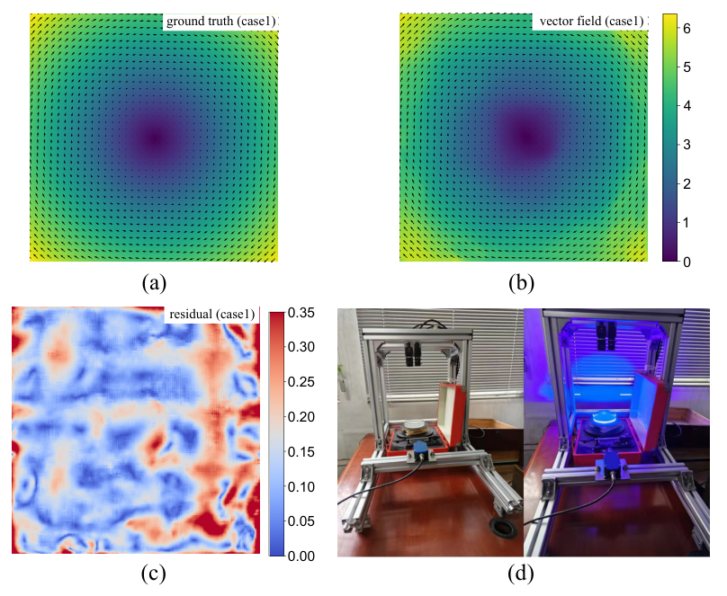

# PIV-FlowDiffuser

**Diffusion models meet particle image velocimetry — accurate flow fields with less training cost.**

[](https://www.mdpi.com/1424-8220/25/19/6077)
[](https://arxiv.org/abs/2504.14952)

Official code for the paper [*PIV-FlowDiffuser: Transfer-Learning-Based Denoising Diffusion Models for Particle Image Velocimetry*](https://www.mdpi.com/1424-8220/25/19/6077) (*Sensors* **2025**, *25*(19), 6077).

---

## What is Particle Image Velocimetry (PIV)?

<p align="center">
  
</p>

**Particle Image Velocimetry (PIV)** is a laser-based, non-intrusive technique for measuring how fluids move. Tiny tracer particles are seeded into the flow and illuminated by a thin light sheet; high-speed cameras then capture pairs of particle images in quick succession. By tracking how particle patterns shift between frames, PIV reconstructs a **velocity vector field** — a map of speed and direction at every point in the measurement plane.

The figure above illustrates the full picture:

| Panel | What it shows |
| :---: | --- |
| **(a)** | **Ground-truth flow** — the reference velocity field for a vortex case |
| **(b)** | **PIV vector field** — the flow recovered from particle images |
| **(c)** | **Residual** — the point-wise error between prediction and truth |
| **(d)** | **Experimental setup** — the real hardware: laser illumination, cameras, and rotating test rig |

PIV is widely used in aerodynamics, turbomachinery, biomedical flows, and turbulence research — anywhere you need to *see* fluid motion without disturbing it. The central challenge is turning noisy, sparse particle images into **dense, high-resolution velocity fields** with sub-pixel accuracy. That is exactly what **PIV-FlowDiffuser** is built for.

---

## Why PIV-FlowDiffuser?

Traditional PIV pipelines rely on cross-correlation and handcrafted post-processing. Deep learning methods improve accuracy but often demand large labeled datasets and heavy compute. **PIV-FlowDiffuser** takes a different path:

- **Diffusion-based denoising** progressively refines optical-flow predictions for sharper, more accurate vector fields
- **Transfer learning** from a pre-trained [FlowDiffuser](https://github.com/LA30/FlowDiffuser) model — general optical-flow features are reused, so fine-tuning on PIV data needs far less time and data
- **Detail denoising step** targets the fine-scale errors that matter most in PIV measurement

<p align="center">
  
</p>

Built on FlowDiffuser's dual encoder, conditional recurrent denoising decoder, and reverse diffusion process, PIV-FlowDiffuser adds scale-transform layers and is comprehensively fine-tuned on PIV benchmarks. Because the backbone already understands motion, the PIV-specialized model trains efficiently — and generalizes robustly across flow types.

<p align="center">
  
</p>

---

## Getting Started

### Install dependencies

Python 3.8 with the following packages:

```shell
pytorch        2.3.1
torchvision    0.18.1
numpy          1.19.5
opencv-python  4.6.0.66
timm           0.6.12
scipy          3.6.2
matplotlib     3.3.4
```

Code lives in the [`PIV-FlowDiffuser/`](PIV-FlowDiffuser/) subdirectory. See `train.sh` and `eval.sh` for training and evaluation entry points.

### Pre-trained weights

Download the fine-tuned model weights here:

**[Google Drive → PIV-FlowDiffuser weights](https://drive.google.com/file/d/1h_JGcjY6AFqyZDMCcZ6Xe-fnDNbrcv-x/view?usp=drive_link)**

---

## Datasets

Training and evaluation use two public PIV benchmark collections:

| Dataset | Link |
| --- | --- |
| Problem Class 1 | [shengzesnail/PIV_dataset](https://github.com/shengzesnail/PIV_dataset) |
| Problem Class 2 | [Zenodo record](https://zenodo.org/records/4432496#.YMmLT6gzZaQ) |

For Problem Class 2 validation, we further split flows into seven categories — `backstep`, `JHTDB`, `cylinder`, `SQG`, `uniform`, `DNS`, and `OTHER`. The full label list is in [`PIV-FlowDiffuser/problem2labels.csv`](PIV-FlowDiffuser/problem2labels.csv).

---

## Results

Side-by-side comparisons against baselines on three benchmark settings:

| Figure | Benchmark |
| --- | --- |
| [1.pdf](1.pdf) | Problem Class 1 — [CAI dataset](https://github.com/shengzesnail/PIV_dataset) |
| [2.pdf](2.pdf) | Problem Class 2 — [CAI dataset](https://github.com/shengzesnail/PIV_dataset) |
| [3.pdf](3.pdf) | Turbulent wavy channel flow (TWCF) |

---

## Citation

If you find this work useful, please cite:

```bibtex
@article{zhu2025pivflowdiffuser,
      title={PIV-FlowDiffuser: Transfer-Learning-Based Denoising Diffusion Models for Particle Image Velocimetry},
      author={Zhu, Qianyu and Wang, Junjie and Hu, Jeremiah and Ai, Jia and Lee, Yong},
      journal={Sensors},
      volume={25},
      number={19},
      pages={6077},
      year={2025},
      publisher={MDPI},
      doi={10.3390/s25196077},
      url={https://www.mdpi.com/1424-8220/25/19/6077},
}
```

---

## Contact

Questions or collaboration ideas? Reach out at **zhuqianyu2@gmail.com**.

---

## Acknowledgements

This project builds on excellent prior work:

- [FlowDiffuser](https://github.com/LA30/FlowDiffuser)
- [caishensnail/PIV dataset](https://github.com/shengzesnail/PIV_dataset)
- [RAFT-PIV](https://codeocean.com/capsule/7226151/tree/v1)
